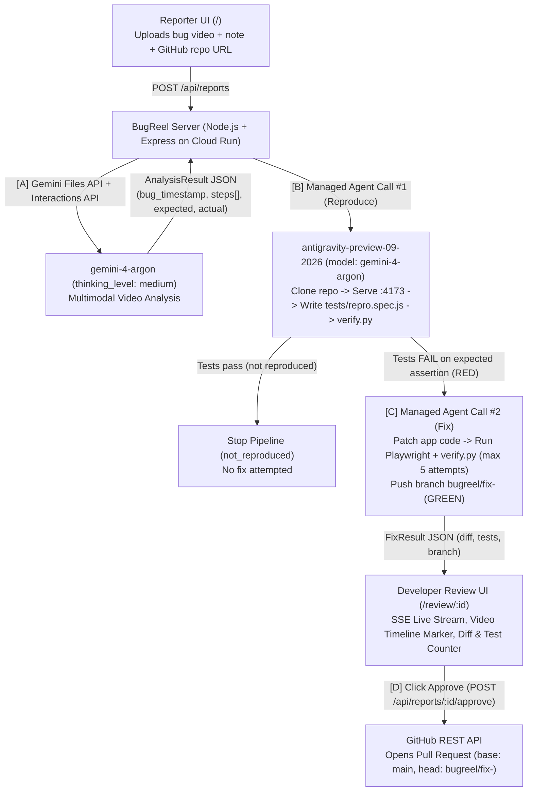

# BugReel

> **BugReel turns a screen-recorded bug report into a failing reproduction test and a verified fix, ready for a developer to approve.**
>
> *Reporters send a video. Developers just approve.*

Built for the **Google DeepMind AI Hackathon Seoul (Track 4 — Open Innovation: Autonomous Agents & Developer Tools)**.

- **Live Cloud Run App:** [https://bugreel-806839438168.asia-northeast3.run.app](https://bugreel-806839438168.asia-northeast3.run.app)
- **Interactive Architecture Diagram:** [https://bugreel-806839438168.asia-northeast3.run.app/architecture.html](https://bugreel-806839438168.asia-northeast3.run.app/architecture.html)
- **Demo Target Repository:** [https://github.com/minjun1177/bugreel-demo-todo](https://github.com/minjun1177/bugreel-demo-todo) *(Based on TodoMVC Vanilla JS under MIT license, with one bug introduced for the BugReel demo)*
- **Sample Pull Request Opened by BugReel:** [https://github.com/minjun1177/bugreel-demo-todo/pull/1](https://github.com/minjun1177/bugreel-demo-todo/pull/1)

---

## 1. Problem & Impact

Who records bug videos? **Not developers.**
QA testers, customer support (CS) specialists, product planners, and end users record their screen when something breaks and attach a one-line note like *"I checked the item, but the counter didn't change."*

Developers are on the receiving end. For every video bug report, a developer has to:
1. Scrub back and forth through the video to spot the exact second the bug occurs and reconstruct the user's clicks and keystrokes.
2. Clone and serve the app locally to reproduce the exact state.
3. Write a failing end-to-end Playwright test to lock in the reproduction.
4. Track down the root cause in application code, verify the fix without breaking existing tests, push a branch, and open a PR.

**BugReel** automates steps 1–4 using **Gemini 4 Argon (`gemini-4-argon`)** multimodal video understanding and the **Google Antigravity Managed Agent (`antigravity-preview-09-2026`)** inside a secure remote sandbox—while keeping the developer in control with a strict **RED → GREEN verification gate** and a **human approval gate** before any Pull Request is opened.

### Target Users

| Role | Who | Does | Gets |
|---|---|---|---|
| **Reporter** | QA, support (CS), planners, end users | Uploads a screen recording + optional one-line note | No need to write manual reproduction steps |
| **Developer** | Repository maintainer | Reviews the video marker, failing repro test, and verified diff; clicks **Approve & Open PR** | Skips rewinding videos, reproducing bugs, and writing boilerplate tests |

---

## 2. What Makes BugReel Different

1. **Video-First Input (`gemini-4-argon` Multimodal Understanding):**
   Takes raw screen recordings (`.mp4`, `.webm`, `.mov`) + a natural-language note in any language, extracting the exact `bug_timestamp` (`M:SS`), chronological UI interaction steps (`type`, `click`, `press`, `reload`, `navigate`), and expected vs. actual behavior.
2. **Strict RED-Before-GREEN Verification Loop (`verify.py`):**
   **No fix is ever attempted without a failing reproduction test first.**
   - In **Call #1 (Reproduce)**, the managed agent writes `tests/repro.spec.js` and runs Playwright + `verify.py`. If the test passes or fails to run, BugReel stops at `not_reproduced` and never guesses a fix.
   - Only when Call #1 produces a confirmed **RED** (`passed < total`) does **Call #2 (Fix)** run to patch application code until all tests turn **GREEN** (`passed === total && total > 0`).
3. **Server-Side Test Integrity Guard (`detectTestFilesChanged`):**
   BugReel parses the unified diff on the server to ensure the agent did not weaken, edit, or delete existing tests under `tests/` outside `tests/repro.spec.js`.
4. **Human Approval Gate:**
   The fix is committed to branch `bugreel/fix-<id>`, and a GitHub Pull Request is opened **only** when the reviewing developer clicks **Approve & Open PR**.

---

## 3. Architecture



Also view the interactive architecture diagram at [`/architecture.html`](https://bugreel-806839438168.asia-northeast3.run.app/architecture.html).

---

## 4. Demo Target Repository (`bugreel-demo-todo`)

To demonstrate BugReel on a realistic open-source codebase without requiring external databases:
- **Repository:** [https://github.com/minjun1177/bugreel-demo-todo](https://github.com/minjun1177/bugreel-demo-todo)
- **License & Attribution:** Based on the vanilla JavaScript example from [TodoMVC](https://github.com/tastejs/todomvc) (MIT License).
- **Introduced Bug (Bug A):** In `src/controller.js`, `Controller.prototype._updateCount` passes `todos.total` instead of `todos.active` to `updateElementCount`. When a user adds 3 todo items and checks one off at `0:07` in `demo/bug.webm` (note: *"체크했는데 숫자가 그대로예요"*), the bottom-left counter remains stuck at `"3 items left"` instead of decrementing to `"2 items left"`.
- **Verified Fix & PR:** BugReel pinpoints `0:07`, generates `tests/repro.spec.js`, confirms **RED (`0 / 1 passed`)**, patches `src/controller.js` (`todos.total` → `todos.active`), confirms **GREEN (`1 / 1 passed`)**, and upon approval opens [Pull Request #1](https://github.com/minjun1177/bugreel-demo-todo/pull/1).

---

## 5. HTTP API & Data Contracts

| Method | Path | Purpose |
|---|---|---|
| `GET` | `/` | Reporter upload page |
| `GET` | `/review/:id` | Developer review page with live SSE progress, video timeline marker, test counter, and diff viewer |
| `GET` | `/architecture.html` | Interactive system architecture & verification loop diagram |
| `POST` | `/api/reports` | `multipart/form-data`: `video` (`mp4`/`webm`/`mov`, ≤ 50 MB), `note`, `repoUrl` → `{ id }` |
| `GET` | `/api/reports/:id` | Full report state JSON |
| `GET` | `/api/reports/:id/events` | Server-Sent Events (SSE) stream of `ReportEvent` |
| `GET` | `/api/reports/:id/diff` | Download unified diff patch (`bugreel-fix-<id>.diff`) |
| `POST` | `/api/reports/:id/approve` | Opens the GitHub Pull Request → `{ prUrl }` |
| `GET` | `/healthz`, `/health`, `/api/healthz` | Health check (`ok`) |

---

## 6. Security Design

- **Zero Untrusted Code on Cloud Run:** Untrusted repository code is cloned, served, and tested **exclusively** inside the isolated `antigravity-preview-09-2026` remote Linux sandbox.
- **Secret Manager & Gemini Credentials API:** `GEMINI_API_KEY` and `GITHUB_TOKEN` are stored in Google Cloud Secret Manager and injected via environment variables on Cloud Run. For sandbox egress, credentials are registered via `client.credentials.create()` so raw tokens never enter the model prompt or sandbox environment.
- **Strict Sandbox Network Allowlist:** Remote sandbox egress is restricted to an explicit domain allowlist (`github.com`, `api.github.com`, `registry.npmjs.org`, and Playwright browser download CDNs) with no wildcard (`*`) rules.
- **No Database / Minimal Surface:** In-memory `Map<reportId, Report>` state, strict `multer` file-size (50 MB) and MIME/extension validation, and HTTPS-only Cloud Run deployment.

---

## 7. Local Development & Verification

### Prerequisites
- Node.js 20+
- Python 3 (stdlib only, for `verify.py`)
- `GEMINI_API_KEY` and `GITHUB_TOKEN`

### Run Locally
```bash
npm install
export GEMINI_API_KEY="your-gemini-api-key"
export GITHUB_TOKEN="your-github-token"
npm start
```

### Run Automated Smoke & Security Tests
```bash
node --test test/smoke.test.js
python3 verify.py
```

### Deploy to Google Cloud Run
```bash
gcloud run deploy bugreel \
  --source . \
  --region asia-northeast3 \
  --allow-unauthenticated \
  --no-cpu-throttling \
  --set-secrets="GEMINI_API_KEY=GEMINI_API_KEY:latest,GITHUB_TOKEN=GITHUB_TOKEN:latest"
```

---

## License
MIT
